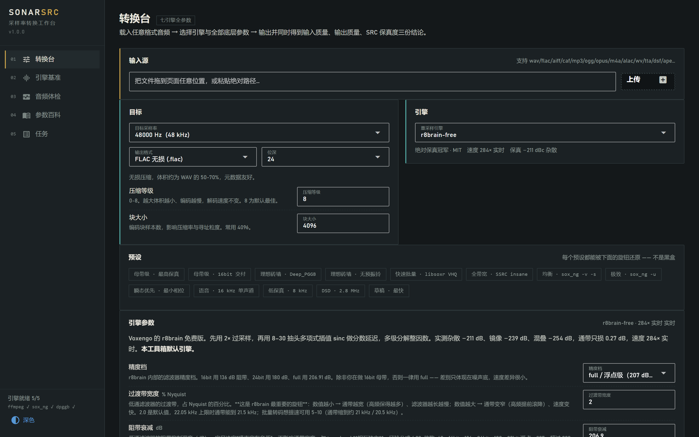

# SonarSRC · 多格式采样率工具箱

[](https://github.com/Maaaaark001/Deep_PGGB)
[](#许可与致谢)

一个用 Python + NiceGUI 写的本地 SRC（Sample Rate Conversion）工作台：
**输入任意格式 → 调参数重采样/转格式 → 对输入质量、输出质量、SRC 本身质量给出可解释的量化结论。**

仓库：<https://github.com/Maaaaark001/Deep_PGGB>

```bash
git clone https://github.com/Maaaaark001/Deep_PGGB.git sonarsrc
cd sonarsrc
pip install -r requirements.txt
python app.py --port 8099          # 打开 http://127.0.0.1:8099
python tests/selftest.py           # 14 项自检，演示素材会自动生成
```

> 仓库含源码、文档、论文成品（docx + pdf）与可复现的测量数据；引擎二进制（`*.exe`/`*.dll`）、
> 第三方 FFTW 库、测试音频与排版预览帧不入库，详见 [仓库说明](#仓库说明)。
>
> **GitHub 与代理**：访问可走 `git config http.proxy http://127.0.0.1:7897`（或 `HTTPS_PROXY`）。
> 但**推送大包时这条代理会返回 HTTP 408** —— 本机实测 2 MB 的 pack 上传被截断，
> 报 `RPC failed; HTTP 408` 与 `unexpected disconnect while reading sideband packet`；
> 去掉 `http.proxy` 直连即可推成功。必须走代理时改用 SSH（`git@github.com` + `~/.ssh/config` 的 ProxyCommand）。



---

## 它解决什么问题

采样率转换是音频链路上最容易"悄悄毁掉高频"的一环，而大多数工具把参数藏起来：

| 常见做法 | 后果 |
| --- | --- |
| SoX `rate` 默认档 | 杂散只有 **−142 dBc**，是所有引擎里最差的一档（换 `-v` 立刻到 −190） |
| FFmpeg `aresample` 默认 | 镜像只有 **−11 dB**，上采样后能直接听见"鬼影" |
| 只看"能不能出声" | 通带被削到 21 kHz、混叠折回可闻带，全都发现不了 |

SonarSRC 把八个引擎的**每一个底层旋钮**都摆到界面上，并给出每个参数的
范围、默认值、代价（速度/延迟/预振铃）与建议；转换完成后再用三组独立测量告诉你
**这次转换到底损失了什么、损失在哪里、听不听得见**。

---

## 快速开始

```bash
# 1) 安装依赖（唯一新增包是 nicegui，闭包约 16MB）
pip install -r requirements.txt

# 2) 准备外部二进制（见下节），然后启动
python app.py                     # http://127.0.0.1:8080
python app.py --port 8123         # 换端口
python app.py --reload            # 开发模式
```

启动时会打印环境自检表（ffmpeg / ffprobe / sox_ng / r8brain / ssrc 各自的路径），
缺任何一个只影响对应引擎，界面照常启动。

### 外部二进制

| 程序 | 用途 | 发现顺序 |
| --- | --- | --- |
| `ffmpeg` / `ffprobe` | 唯一解码器；mp3/ogg/opus/aac/alac/wv/tta 编码 | `$FFMPEG` → PATH → `%TEMP%\ffm\...` → `./bin` → imageio_ffmpeg |
| `sox_ng` 14.9 | rate 重采样 + 大部分编码 + 抖动噪声整形 | `$SRCTOOL_BIN` → `./bin` → `~/.dsh/skills/src-toolchain/bin` → PATH |
| `r8b` (r8brain-free) | 保真冠军引擎 | 同上 |
| `ssrc` (Shibatch) | 全带宽引擎 | 同上 |
| `dpggb` (Deep_PGGB) | 自研理想砖墙引擎（带 FFTW DLL，按**文件夹**发现；优先用 `dpggb.dll` 进程内调用） | `./deeppggb` → `~/.dsh/skills/src-toolchain/deeppggb` |

---

## 五个页面

### 1. 转换台 `/`
输入源（**把文件拖到页面任意位置**、点"上传"、或粘贴绝对路径）→ 目标采样率/格式/位深 → 引擎 → 预设 → **引擎参数** → 处理选项 → 执行。

转换结果一次性给出五块内容：
- **结果**：输出采样率、帧数、耗时、倍速、下载链接
- **SRC 质量结论**：这次转换的零差深度、通带、相位、速度判级
- **输入质量结论 / 输出质量结论**：峰值、真峰值、LUFS、有效位深、带宽、直流、削波、立体声场
- **绝对保真度**（当被测引擎就是参考引擎时）：合成音测出的杂散/镜像/混叠/通带/SINAD
- **零差测试**：与 r8brain-strict 参考的逐频带差异柱状图 + 频谱对比 + 频谱图

### 2. 引擎基准 `/engines`
勾选任意几台引擎 → 后台并行测量 → 杂散/镜像/混叠/互调/多音/通带 + SINAD/SFDR/ENOB 对比表 + 三张图 + 自动判级。
其中"互调失真（线性度）"专图对比 CCIF 与 SMPTE 两项——单音只回答"有没有多余谱线"，
两个音同时存在时会不会长出第三个音，才是线性度的直接判据。
结果会缓存到 `cache/bench.json`，"载入上次结果"可随时回看。

### 3. 音频体检 `/analyze`
对任意文件做完整测量（不转换）：电平、响度、真峰值、有效位深、带宽、直流、削波、
立体声场、频谱、频谱图、波形包络，并给出每条指标的中文结论。
页面顶部会显示**分析范围**：`全长`（≤10 分钟，逐样本）/ `抽样`（更长但体积允许时均匀抽 5 段 × 60 秒）/
`截断`（高采样率多声道导致解码体积超预算）。用的是哪一档、为什么，都会写清楚。

### 4. 参数百科 `/glossary`
21 个指标词条 + 八台引擎的全部参数说明 + 13 个预设的构成。
**这里的内容和界面上参数旁的说明来自同一份数据**（`srctool/presets.py` 与 `srctool/engines.py`），不会出现两处说法不一致。

### 5. 任务 `/jobs`
后台线程里的转换与测量任务，关掉页面不中断。

---

## 八台引擎

| key | 引擎 | 特点 | 实测杂散 |
| --- | --- | --- | --- |
| `dpggb` | **Deep_PGGB**（自研） | 近理想低通，任意倍率；对精确参考 302.6 dB（PGGB 302.0 dB，不可区分）；四项失真列不劣于 PGGB、多音持平；速度 180× 对 43×（r8brain 109×）；**上行方向唯一把通带保持到源奈奎斯特**（22.049 kHz −0.05 dB） | −304.2 dBc |
| `pggb` | **PGGB（原版，仅基准）** | 商用离线工具，精度与 Deep_PGGB 不可区分；**只接受整数倍率、无降采样**，因此只出现在基准页，不参与转换 | −304.0 dBc |
| `r8b` | r8brain-free | 第三好的保真度，MIT | −283.6 dBc |
| `soxng` | sox_ng 14.9 `rate` | 旋钮最全，编码/抖动也归它 | −186.6 dBc (`-u`) |
| `ssrc` | SSRC / Shibatch | **下行**保到 22 kHz（降采样方向最宽）；上行在 22.05 kHz 陡降 125 dB | −152.2 dBc (insane) |
| `soxr` | libsoxr | 全场最快（60 s 立体声 44.1→88.2 达 658× 实时） | −195.7 dBc |
| `swr` | ffmpeg `aresample` | 生态最广，但通带 21 kHz 已 −4.1 dB、21.5 kHz −31.4 dB | −195.7 dBc |
| `scipy` | `resample_poly` | 纯 Python 参考实现 | −86.2 dBc |

> 杂散一列是**整数相位激励 + 1 秒居中窗 + 泄漏免疫口径**（扣掉基频 bin 后的残余）下的读数。
> 早期用 `sin(2πft)` 生成激励时，4 秒 88.2 kHz 的相位累积误差本身就是 −257 dBc，
> 把 Deep_PGGB 与 r8brain 的 109 dB 差距压成 42 dB；改用单根谱线口径又会读到基频的窗泄漏裙边。
> 低于 −250 dB 的任何数字，都得先确认尺子比被测对象准。
>
> `pggb` 是**对照引擎**：`pggb_256_it.exe` 的倍率参数只接受整数（喂 1.5 或 48000 会被静默当成 1），
> 也没有降采样路径，所以它在基准页按 44.1→88.2（×2）口径测量、混叠项显示 `n/a`，
> 并且不出现在转换台的引擎下拉里。

### 原生流式 API（Deep_PGGB）

FIFO、游标与窗口拼接现在在 C++ 引擎内，Python 只负责按块喂入：

```python
from deeppggb.deeppggb_stream import NativeStreamResampler

rs = NativeStreamResampler(44100, 88200, 2, core_sec=1.0)  # 时延 1.8 s
y = rs.push(x_chunk)     # (frames, 2)，返回已就绪的核心输出
tail = rs.flush()        # 流结束，内核在尾部做 20 ms 渐变
rs.close()
```

同一窗口几何下，60 s 立体声 44.1→88.2 的吞吐从 Python 外挂补丁的
9.6/13.5/18.4×（core 0.5/1.0/2.0 s）提高到 **31.9/47.6/70.8×**；原因是每窗口不再启动
`dpggb.exe`、不再写临时文件，且 FFT plan 在进程内共享、不随窗口重建。原生输出与 Python
`StreamResampler` 逐位相同（4 s 多音测试），与离线整文件在 200 ms 后的内部零差为 122 dB。
非 Windows 或 DLL 缺失时仍可用纯 Python 的 `StreamResampler` 回退。

每台引擎的参数都在界面上逐条可调，包括 r8brain 的精度档/过渡带/阻带/相位、
sox_ng 的预设/陡峭度/通带/阻带抑制/相位百分比、
SSRC 的 profile/dither、libsoxr 的精度/相位、swr 的滤波器尺寸/相位/抖动、
Deep_PGGB 的分块长度/并行工作数/内存上限/首尾渐变/分块上下文/滚降宽度/滚降阶数/块边缘渐变/
最小相位抽头/渐变形状/计算精度/相位响应/线程数。

---

## 质量方法论

**双轨制**，因为"绝对保真"和"和参考有多接近"是两个不同的问题。

### 轨一：合成音绝对测量（可复现的硬指标）
- 激励：0.5 幅度正弦，**整数 Hz** 频率，**16 秒**（不是 4 秒：4 秒片段里 20 ms 首尾渐变占 0.5%，
  边界效应会把读数压低 5–9 dB，而真实素材以分钟计）
- 分析窗：**5 个互不重叠的 1 秒窗**（各 = fs_out 个样本），每项指标取 5 个读数的**中位数**
  （分块引擎的接缝会让单个窗口偏 5–10 dB，取中位数对窗口位置不敏感）
- 整数 Hz + 整秒窗 ⇒ 矩形窗 FFT 无泄漏，旁瓣不会伪装成杂散
- 杂散 = 扣掉基频所在 bin 后的残余能量（泄漏免疫口径，等价于对基频做最小二乘拟合再相减）
- 镜像 = 从镜像频率到输出奈奎斯特的**带能量**，参考取输出里基频的实测电平（不是输入幅度）
- 混叠 = 1 kHz 参考音 + 30 kHz 侵略音**同时在场**，读折叠 bin 相对参考音（96→44.1）
- 通带 = 21.5 kHz / 22.0 kHz 处相对 1 kHz 的增益
- 互调 CCIF = 19 kHz + 20 kHz 各 0.25 幅度，测 2f1−f2 / 2f2−f1 / f2−f1 / f1+f2
- 互调 SMPTE = 60 Hz(0.40) + 7 kHz(0.10)，测 7 kHz ± 60 / ±120 Hz 边带
- 多音残余 = 24 个对数等间隔音（100 Hz–18 kHz，Schroeder 相位），扣掉各音 bin 后的剩余能量

> **五个分析地板**（把同一组频率直接在目标采样率上合成、完全不重采样，读数就是极限）：
> 单音杂散 −307.1、镜像 −320.2、CCIF −334.4、SMPTE −334.7、24 音残余 −295.2 dBc。单音 SINAD/SFDR/ENOB 用残差法另算：Deep_PGGB 305.8 dBc / 320.2 dBc / 51.5 bit，20 kHz 带内 307.3 dBc（51.8 bit）；原版 PGGB 的平稳区 307.4 dBc 与之不可区分，但按整段文件统计时它的最差一秒只有 183.6 dBc（首尾过渡区），Deep_PGGB 每一秒都在 305.6–307.4 dBc。
> 贴在地板上的读数只能说明"低于测量能力"，而且**换了块长/精度就会摆动 4–5 dB**，
> 谈不上排序；只有明显高于地板的才是真实失真（r8brain −283.8、sox_ng −186.6、SciPy −86.2）。
>
> **混叠口径的历史坑**：早期只送一个 30 kHz 阻带音、除以固定 0.5 作分母。
> sox_ng 对纯阻带输入返回逐位精确的全零（44100/44100 个 0.0），于是分子分母同时趋于零，
> 读数落到 EPS 上给出 −394 dBc 的"完美"成绩。改成双音口径后它读 −221.0 dBc，从第一变倒数第三；
> Deep_PGGB 是 −353.5 dBc，领先 132 dB。**任何"抑制能力"的排名，先看分母是什么。**

### 轨二：真实文件零差测试（相对参考的偏差）
以 r8brain-strict（1% 过渡带 / 250 dB 阻带）的输出为参考，把被测引擎的输出与之相减：

1. **整数对齐**：互相关找滞后
2. **亚样本对齐**：在 ±1 样本内两级实测搜索（粗扫 0.05，细扫 0.002），
   用 0.5 秒真实残差平方和挑最优 —— 抛物线插值估相位在这里精度不够，
   0.002 样本的残差就能让 15 kHz 的零差从 90 dB 掉到 34 dB
3. **分频带**：0–1k / 1–5k / 5–10k / 10–16k / 16–20k / 20k+ 各自算残差电平

> **为什么判级用"可闻带深度"而不是全带深度**
> 两个都正确的引擎，差异一定集中在过渡带（近 Nyquist）。全带 RMS 会被
> 20 kHz 以上的超声差异完全主导：r8brain 默认档 vs strict 的全带零差只有 36.6 dB，
> 但 0–16 kHz 的差值在 −109 ~ −122 dBFS，20 kHz 以上才是 −53.6 dBFS。
> 人耳听不到 20 kHz 以上，用全带值判级会得出"默认档很烂"的错误结论。
> 所以判级用**滤掉 20 kHz 以上后的可闻带深度**（同一例是 87.2 dB），
> 全带值仍然报出来，用于排查滤波器设计差异。

### 判级标准

| 指标 | 优秀 | 可用 | 可疑 |
| --- | --- | --- | --- |
| 杂散 | < −180 dBc | < −120 dBc | > −100 dBc |
| 镜像 | < −150 dBc | < −100 dBc | > −40 dBc |
| 混叠 | < −150 dBc | < −90 dBc | > −40 dBc |
| 通带 21.5 kHz | > −0.5 dB | > −3 dB | < −6 dB |
| 零差（可闻带） | > 90 dB | > 60 dB | < 40 dB |
| 互调 CCIF | < −200 dBc | < −150 dBc | > −120 dBc |
| 多音残余 | < −200 dBc | < −150 dBc | > −120 dBc |

---

## 论文与复现

**《任意有理倍率的分块频域重采样方法——误差分解、流式扩展与八引擎对照》**
25 页 / 10 图 / 6 表 / 26 条参考文献。

- [论文 docx](work/paper/Deep_PGGB_paper.docx) · [论文 pdf](work/paper/Deep_PGGB_paper.pdf)
- [学术评审](work/paper/REVIEW_academic.md) · [写作评审](work/paper/REVIEW_writing.md) · [闭环修改记录](work/paper/REVIEW_closed_loop.md)

论文把“频域补零”当作经典方法处理，贡献放在**误差分解、测量协议、分块与流式扩展**：

- §2.5 给出整段处理、分块处理、核心区、上下文、引擎内分块、独立分段拼接、整相位、零差等术语；
- 式 (4)–(15) 给出增益精修、零差、音乐分块-整段零差、杂散、镜像、混叠、CCIF、SMPTE、多音、SINAD、SFDR、ENOB 的完整定义；
- 九种倍率的零差为 300.9–303.8 dB，PGGB 在 44.1→176.4 上为 302.0 dB；
- 八引擎对照中前五台贴 float64 地板，有区分力的是 r8brain、sox_ng、SSRC、SciPy；
- 2 分钟真实音乐上，Deep_PGGB 引擎内分块为 175.2 dB，独立拼接只有 30.2 dB；其余七台为 41.3–91.6 dB；
- 8 声道合成 303.9–305.8 dB，吞吐 28.2×；2 分钟音乐吞吐 135×。

复现入口：

```bash
python work/figures/gen_figures_new.py        # 9 张图：PNG/PDF/SVG
python deeppggb/dp_engine_music_8ch.py        # 表 6 的音乐 / 8 ch 跨引擎数据
python deeppggb/dp_speed_ci.py                 # 吞吐的 95% bootstrap CI
bash work/paper/merge.sh                       # 分段稿合并为 blocks.json
python work/paper/build_docx.py                # python-docx 渲染 py_raw.docx
python work/paper/embed_figures.py work/paper/py_raw.docx work/paper/Deep_PGGB_paper.docx work/figures/png
python work/paper/qa_docx.py                   # 结构校验
```

> 论文里的音乐基准使用本地 `music/Pixabay.mp3`，该文件不入库；完整复现表 6 需先准备该文件
> （2 分钟、44.1 kHz 立体声）。合成音与 8 ch 部分由 `deeppggb/dp_multichannel.py` 单独生成。
> 完整构建链与常见坑见 `AGENTS.md` 的 D8。

---

## 支持的格式

**输入**：wav / flac / aiff / caf / w64 / au / mp3 / ogg / opus / m4a(aac/alac) / wv / tta / dsf / ape …
（只要 ffmpeg 能解就能读，解码统一走 `-f f64le`，**绝不中途降到 16 bit**）

**输出**（14 种容器）：

| 容器 | 编码器 | 无损 | 位深 |
| --- | --- | --- | --- |
| wav / flac / aiff / caf / w64 / au | sox_ng | ✓ | 8/16/24/32f |
| dsf | sox_ng (SDM) | ✓ | DSD64–DSD512 |
| mp3 / ogg / opus / m4a(aac) | ffmpeg | ✗ | 有损，位深设置不生效 |
| m4a(alac) / wv / tta | ffmpeg | ✓ | 16/24 |

---

## 项目结构

```
app.py                 启动器（uvicorn）
srctool/
  config.py            路径/二进制发现/常量
  probe.py             ffprobe 元数据
  codecs.py            格式注册表 + 解码/编码
  engines.py           8 台引擎 + 参数表（含中文说明）
  metrics.py           音频质量指标
  quality.py           SRC 质量测量与判定（合成音 + 零差）
  pipeline.py          转换流水线
  presets.py           11 个预设 + 17 个百科词条
  plans.py             长文件分析策略（全量 / 抽样 / 截断）
  plot.py              ECharts option 构建器
  jobs.py              后台任务队列
  server.py            FastAPI 应用（/files 静态输出、/api/upload 拖放上传）
  ui/theme.py          设计系统（CSS 变量/字体/响应式）
  ui/components.py     可复用组件
  ui/pages.py          五个页面
tests/selftest.py      自检（不依赖 pytest）
```

## 长文件与内存

工具对长素材是认真处理的，不是"只取前 30 秒"：

- 解码一律 `ffmpeg -f f64le` 落 `float64`，超过 256 MB 自动转成 **memmap**（磁盘映射，不占内存）。
- 所有指标（响度、真峰值、有效位深、静段电平、立体声场、频谱图）都**分块流式**计算：
  LUFS 用 K 计权平方的**前缀和**求块能量，真峰值用 `soxr.ResampleStream` 流式 4× 过采样。
  424 秒立体声的体检峰值内存约 **334 MB**，耗时约 6–9 秒。
- 零差测试对超长素材取**文件中间 90 秒**（并在结论里注明），因为两遍重采样 + 亚样本对齐搜索
  在小时级素材上是分钟级，而滤波器差异在 90 秒里早已暴露无遗。

## 自检

```bash
python tests/selftest.py
```

覆盖：二进制发现 → 解码 → 八台引擎 → 指标 → 质量测量 → 零差 → 编码 → 流水线 → 绘图数据 → 预设一致性。
全部通过时退出码为 0。

## 设计说明

界面刻意采用**测量仪器 / 广播机架 / 校准铭牌**的视觉语言，而不是通用 SaaS 仪表盘：

- 双强调色带语义：**黄铜 = 参考/输入/基准**，**铜绿 = 信号/输出/主操作**
- 数字一律用等宽字体 + tabular-nums，方便竖排比对
- 背景是 24px 方格纸底纹，模拟校准图纸
- 不使用圆角卡片阵、统一阴影、渐变洗色、近黑底荧光绿这些"生成式默认"

## 仓库说明

仓库**只提交源码、文档、测量数据与论文成品**，二进制、本地素材与排版中间件由 `.gitignore` 排除：

| 排除项 | 原因 | 如何获得 |
|---|---|---|
| `*.exe` / `*.dll` / `deeppggb/third_party/` | FFTW 与自研二进制约 14 MB，可重建 | `bash deeppggb/build.sh`（需 MSYS2 UCRT64） |
| `*.univer` / `work/paper/pages*/` / `v*_pages/` / `*_contact.png` / `crop_*.png` / `py_raw.docx` | 论文排版的预览帧与中间 docx | 由 `build_docx.py` + `embed_figures.py` 重新生成 |
| `work/paper/Deep_PGGB_paper_v*.pdf` | 历史版本，最终 PDF 保留 | 只保留 `Deep_PGGB_paper.pdf` |
| `*.wav` / `*.flac` / `*.npy` / `music/` | 测试音频可合成；音乐样本仅本地 | `tests/selftest.py` 自行生成；音乐基准需自备 `music/Pixabay.mp3` |
| `cache/` | 运行时缓存 | 自动重建 |

保留：`srctool/`、`deeppggb/*.py` 与 `src/`、`tests/`、`work/paper/*.py|*.sh|blocks.json`、
`work/figures/`（PDF+SVG+PNG 三套）、`work/paper/Deep_PGGB_paper.docx`、
`work/paper/Deep_PGGB_paper.pdf`、`work/*.json` 测量数据。

## 许可与致谢

本项目自身代码可自由使用。内置调用的第三方组件各自遵循其许可：
r8brain-free（MIT）、SoX / sox_ng（GPL/LGPL）、SSRC（LGPL）、libsoxr（LGPL）、FFmpeg（LGPL/GPL）。
