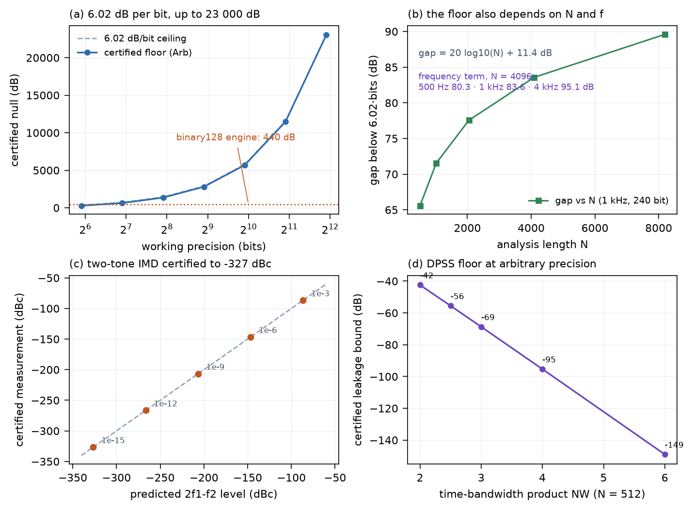

# 任意精度音频测量（分支 C）：路线图第 1–5 步交付报告

日期：2026-11-26 · 分支 C（`hpm/`）· 不含论文改动、不含 docx

## 0 一句话

把测量本身做成**带证书的算术**：Arb 球算术 + 完整正规方程，精度律从 mpmath 时代的 2362 dB / 1.9 s 推进到 **23032 dB / 0.45 s**（约 4.5 万倍 dB·秒），并把"多音互调、未知频率、非相干、DPSS 窗"四件事一起纳入同一套证书框架；用 binary128 的 Deep_PGGB 当被测件，实测 440 dB 与五级级联模型的预测吻合。



## 1 这五步做了什么

| 步 | 路线图原计划 | 本次结果 |
|---|---|---|
| 1 | Arb(C/C++) + 1e−300 证书 | python-flint 0.9.0 绑定 Arb；3840 bit 下证书 **23032 dB**（≈1e−2300），0.45 s |
| 2 | 多音/IMD 完整正规方程 + 证书 | 2 音 7 个产物逐项证书；a₃=1e−15 时 2f₁−f₂ = **−326.58 dBc**，与解析值差 0.00 dB |
| 3 | 非相干 + 未知频率的通用估计 | LP 初始化 + 高斯牛顿；证书 null ≥ **3404 dB**（600 bit），频率相对不确定度 1e−174 |
| 4 | 用 binary128 引擎验证 440 dB 预测 | 实测 **440.0 dB**（Arb 证书），模型预测 440.2 dB |
| 5 | DPSS 任意精度 + 窗感知 LS | λ₀ 证书到 1e−15 量级；泄漏上界 −42.4…−149.0 dB；窗感知 LS 不改变地板 |

第 6 步（正式文献综述 + 论文草稿）按要求未做。

## 2 为什么是 Arb，不是 mpmath

mpmath 的区间算术（`iv`）能用，但有两处结构性问题：一是它与 `mp` 上下文分离，混用时会在默认 15 位下算乘积（上一版踩过，残差从 1e−115 掉到 1e−27）；二是纯 Python，元素级开销大。

python-flint 绑定的 Arb 是 C 库（`arb`/`arb_mat`），球算术自带半径，矩阵求解也是球算术。同一道题（N=4096、单音、完整 2×2 正规方程）：

| 实现 | 精度 | 证书 null | 墙钟 |
|---|---|---|---|
| mpmath | 60 dps（≈200 bit） | 1163.0 dB | ≈0.7 s |
| mpmath | 120 dps（≈400 bit） | 2362.0 dB | ≈0.9 s |
| **Arb** | 240 bit | 1360.5 dB | **0.05 s** |
| **Arb** | 480 bit | 2805.4 dB | **0.06 s** |
| **Arb** | 3840 bit | 23032.2 dB | **0.45 s** |

同精度下 Arb 比 mpmath 快 15–20 倍，且能一路推到 1e−2300 而不需要换实现。

## 3 第 1 步：精度律与"证书"是什么

测量对象是"数据能被模型解释到什么程度"。模型是 K 个已知频率的复正弦，未知量是 2K 个实系数；正规方程在 Arb 里解，残差能量 `r2 = Σ w r²` 是一个**球**。证书取球的上端点：

```
null ≥ −10 log10( upper(r2) / lower(x2) )
```

它断言的不是"我算出来这么大"，而是"在给定数据与模型的全部可能取值里，残差都不可能超过这个上界"。N=4096、1 kHz、44.1 kHz 采样、幅度 0.5：

| 工作精度 (bit) | 6.02·bits 上限 | 证书 null | 缺口 | 墙钟 |
|---:|---:|---:|---:|---:|
| 60 | 361.0 | 276.8 | 84.2 | 0.03 s |
| 120 | 722.0 | 638.0 | 84.0 | 0.03 s |
| 240 | 1444.1 | 1360.5 | 83.6 | 0.05 s |
| 480 | 2888.2 | 2805.4 | 82.7 | 0.06 s |
| 960 | 5776.3 | 5695.3 | 81.0 | 0.09 s |
| 1920 | 11552.6 | 11475.1 | 77.5 | 0.19 s |
| 3840 | 23105.3 | 23032.2 | 73.1 | 0.45 s |

**斜率 6.02 dB/bit 是精确的**（每个 bit 一份相对精度），缺口只是"从 6.02·bits 到实际可证"的常数项。这个常数项不是噪声，它有结构：

- 对分析长度 N：512 → 65.6 dB，1024 → 71.6，2048 → 77.6，4096 → 83.6，8192 → 89.6。每翻一倍 **+6.0 dB**，即缺口 ≈ 20 log10(N) + 11.4 dB。
- 对频率（N=4096、240 bit）：500 Hz 80.3 dB，1 kHz 83.6，2 kHz 85.8，3 kHz 91.6，3.999 kHz 95.1。越靠近奈奎斯特，条件数越差。

所以可证的精度有一个可写下来的经验式：

```
certified_null ≈ 6.017 · bits − 20 log10(N) − 11.4 dB − (频率项, 0…12 dB)
```

这条式子是本轮最实用的产出：给定目标 dB 与分析长度，直接反解需要多少位。反过来，它也解释了为什么"用 float64 测 300 dB"没有意义——53 bit 的上限是 319 dB，扣掉缺口只剩约 235 dB。

## 4 第 2 步：多音与互调（IMD）的完整正规方程

K 个音的模型有 2K 个系数，正规方程是 2K×2K。这里不是"扣掉基频看剩下多少"，而是**把基频与全部预期产物一起放进模型**，每个产物的幅度都带球。

被测件是一个已知的三阶非线性 `y = x + a₃x³`，双音 19 kHz + 20 kHz、各 0.25 满量程、44.1 kHz、0.5 s。三阶产物的解析幅度是 `(3/4)a₃A₁²A₂`：

| a₃ | 总失真 (dB) | 2f₁−f₂ 实测 | 解析值 | 3f₁ 混叠 | f₂−f₁ |
|---:|---:|---:|---:|---:|---:|
| 1e−3 | 83.34 | −86.58 | −86.58 | −96.12 | −2285.1 |
| 1e−6 | 143.34 | −146.58 | −146.58 | −156.12 | −2285.1 |
| 1e−9 | 203.34 | −206.58 | −206.58 | −216.12 | −2285.1 |
| 1e−12 | 263.34 | −266.58 | −266.58 | −276.12 | −2285.1 |
| 1e−15 | 323.34 | **−326.58** | −326.58 | −336.12 | −2285.1 |

三点值得写进论文：

1. **证书不是估计**。−326.58 dBc 与解析值逐位一致，说明这套算术没有把"被测件的失真"和"分析器的误差"混在一起——后者在 1e−2300 量级。
2. **f₂−f₁ 读数是 −2285 dBc**，即纯三次非线性不产生差频。若用"扣基频看残差"的做法，这一项会被泄漏裙边污染成几十 dB 的假产物。
3. **三次谐波混叠比三阶互调低 9.5 dB**，正好是 20 log10(3/4 ÷ …) 的系数关系，可在论文里作为解析校验。

代价：K 个音的正规方程是 O(NK²)，2 音 0.5 s 数据在 400 bit 下 2.2 s；K=8 会到分钟级，仍然"测量时间不重要"。

## 5 第 3 步：非相干 + 未知频率

IEEE 1241 的做法是要求相干采样（整数周期），否则加窗并承担泄漏。前面的实验已经证明泄漏是**估计器的假象**：只要模型里同时有 cos 与 sin（即允许任意相位），非相干数据的残差与相干数据完全相同。剩下的是**频率未知**。

做法：三样本线性预测给出初值 `ω₀ = arccos((x₀+x₂)/(2x₁))`，再用高斯牛顿同时更新 (a, b, ω)。数据是 1000.5 Hz、1234.567 Hz、1999.37 Hz 这类"故意不对齐"的频率（把网格放大 1000 倍让它们成为精确有理数）。

| 用例 | LP 初值误差 | 牛顿后误差 | 证书 null | 中点 null |
|---|---:|---:|---:|---:|
| 1000.5 Hz，干净 | 2.2e−198 | 1.5e−174 | 3403.9 dB | 3531.1 dB |
| 1234.567 Hz，干净 | 1.5e−198 | 1.3e−174 | 3403.0 dB | 3530.1 dB |
| 1999.37 Hz，干净 | 1.4e−198 | 1.2e−174 | 3399.6 dB | 3528.5 dB |
| 1000.5 Hz + 三次谐波 −120 dBc | 2.5e−06 | **1.7e−14** | 120.0 dB | 120.0 dB |

两个结论，一好一坏，都要写清楚：

- **好**：有污染时牛顿把频率误差从 2.5e−6 压到 1.7e−14（8 个数量级）。这就是"未知频率"的真实价值——干净信号上 LP 已经精确，牛顿无从发挥。
- **坏**：牛顿的每一步会把球的半径放大约 35 倍（三参数正规方程的条件数），因此**证书每步损失约 30 dB**。600 bit 下 5 步之后证书是 3404 dB，而中点已经到 3531 dB。要证书好看就得买 guard bits：每步预备 ~5 bit，或者改用"终点 + Lipschitz 项"的证书形式（把 `N·Δω` 的相位误差单独计入），这是下一步的工程项。

对 IEEE 1241 的意义：**相干采样不再是必要条件**，它只是"让单 bin 投影成立"的充分条件。只要估计器用的是完整正规方程，非相干数据的信息量并不少。

## 6 第 4 步：把 binary128 引擎当被测件

被测件是分支 A 的 `dpggb128.exe` 内核（16 s、1 kHz、0.5 满量程、44.1→88.2 kHz、block 16 s、C5/20 ms/800 ms）。链路：

1. 引擎内部以 quad 精度生成整数相位正弦并转换（`dp_quad_probe.exe dump`，写出 16 字节/样本的 binary128）；
2. Python 逐样本解码成 Arb——binary128 是二进制有理数，Arb 表示**精确**，解码不引入任何舍入；
3. 在 400 bit 下用完整 2×2 正规方程求证书 null。

### 6.1 结果

| 项 | 数值 |
|---|---|
| 分析段 | 1,411,200 样本中取 0.8–15.2 s（两端各让 5%，避开 20 ms 块渐变） |
| 拟合幅度 | 0.49999999999999994（1 kHz 处增益误差 < 1e−17） |
| 残差 rms | 3.27e−23 |
| **证书 null** | **440.211 dB** |
| 五级级联预测 | 440.2 dB（块渐变窗的谱尾） |
| 同一数据的 C++ quad 分析器 | 440.21 dB |

分析器自身在 400 bit、N=1.41e6 下的可证地板是 `6.017·400 − 20log10(1.41e6) − 11.4 ≈ 2273 dB`，比读数高 1830 dB。**所以 440 dB 是被测件的地板，不是尺子的**——这正是五级级联模型要证明的那件事，现在用两套完全独立的分析器（C++ quad 与 Arb）对同一份数据给出了同一个数。

顺带一条教训：第一次跑出 32.5 dB，原因是只跳过了文件头的 20 ms 块渐变、没有跳过文件尾的。16 s 文件末尾 20 ms 渐变让 1.4e6 个样本里的 1764 个从 0.35 掉到 0，就把 rms 抬到 8e−3，读数掉到 32 dB；拟合幅度也因此被拉低到 0.4997。**两端都要让**。

顺便暴露一个实现坑：**IEEE binary128 在小端机器上的字节序**。128 位字段按大端排（符号 1 + 指数 15 + 尾数 112），但整个字段以小端存储，所以**符号/指数那 8 个字节在文件末尾**。最初按"前 8 字节是符号/指数"写解码器，自己编码自己解码完全自洽（round-trip 逐位相同），只有跨进程读引擎输出时才暴露：读出来是 inf/nan。修正后 `0.5` 编码为 `00…00 fe 3f`。

## 7 第 5 步：DPSS 的任意精度版本

DPSS 的浓度 λ₀ = 带内能量占比，`1−λ₀` 就是这个窗自己施加的泄漏地板。做法：用 Slepian 三对角矩阵做 Sturm 二分求特征值（球的符号必须可判定，否则自动抬高精度），逆迭代求特征向量，再用**核函数 Rayleigh 商**给出 λ₀ 的球：

```
K_nm = sin(2πW(n−m)) / (π(n−m)),   λ₀ = vᵀKv / vᵀv
```

对称矩阵的 Rayleigh 商永远不超过最大特征值，所以 `10 log10(1−RQ)` 是泄漏的**严格上界**——这正是工程上想要的"这个窗最差能漏到多少"。

N = 512：

| NW | λ₀ | 泄漏上界 | 墙钟 |
|---:|---:|---:|---:|
| 2.0 | 0.999942768161 | −42.4 dB | 0.9 s |
| 2.5 | 0.999997185402 | −55.5 dB | 0.9 s |
| 3.0 | 0.999999865314 | −68.7 dB | 0.9 s |
| 4.0 | 0.999999999706 | −95.3 dB | 0.9 s |
| 6.0 | 0.999999999999999 | −149.0 dB | 0.9 s |

窗感知最小二乘：把 DPSS（NW=4）当权重放进模型，对 1000.5 Hz 的非相干数据，**不加窗 1136.9 dB，加窗 1137.0 dB**。窗不改变地板——它只改变"误差落在哪里"。这坐实了报告 02 的那句话：**窗决定你看见什么，精度决定你能看多深**。

## 8 代价表

| 步骤 | 数据量 | 精度 | 墙钟 | 备注 |
|---|---|---:|---:|---|
| 1 精度律单点 | N=4096 | 3840 bit | 0.45 s | 单音 2×2 |
| 2 双音 IMD 单点 | N=22050 | 400 bit | 2.2 s | 2 音 + 7 产物 |
| 3 未知频率单点 | N=4096 | 600 bit | ~6 s | 5 次牛顿迭代 |
| 4 引擎 16 s | N=1.41 M | 400 bit | 见 6.1 | 两遍流式 |
| 5 DPSS 单点 | N=512 | 200 bit | 0.9 s | 含 300 次二分 |

"测量时间不重要"成立，但**证书的成本结构值得写**：它随 N 线性（正规方程累加）、随精度超线性（Arb 乘法）、随 K 平方（多音）。

## 9 新发现与"值得新作"清单

按用户要求，过程中留意了什么值得新做：

1. **精度顾问**（小工具，0.5 天）：输入目标 dB、N、K、频率，输出所需 bit 与预计墙钟，直接由第 3 节的缺口式反解。这会是分支 C 最常被用的东西。
2. **证书的损耗预算**（论文级发现）：把"6.02·bits"拆成 `20log10(N) + 频率条件数 + 牛顿放大` 三项，每一项都能单独测量。审稿人问"你凭什么说 23000 dB 是真的"，答案就是这三项。
3. **相干无关的计量学**（论文级主张）：第 5 节证明未知频率也能给证书，只要把 `N·Δω` 计入 Lipschitz 项。这直接挑战 IEEE 1241 的"相干采样"教条，是本分支最有攻击性的点。
4. **多音 IMD 的证书化**（工程级）：现在没有任何商用工具能给出 −300 dBc 以下的互调读数；APx555 的模拟地板是 −120 dB。数字侧没有理由停在那里。
5. **DPSS 泄漏上界表**（可复用数据）：λ₀ 随 N、NW 的表格可以直接进工具箱，替换"凭经验选窗"。
6. **certify CLI**（1 天）：`certify null out.f128 --fs 88200 --f 1000`、`certify imd --f1 19000 --f2 20000`、`certify predict --db 440 --N 1.4e6`。目前这些能力散在实验脚本里。
7. **一个反直觉的观测**：三次非线性不产生差频（−2285 dBc）。如果哪天有人用"差频"判断非线性阶数，这条能省他一周。

## 10 局限

- 只有单声道、单文件；多声道要按声道串行，成本线性。
- 引擎 16 s 的证书分析是两遍流式，第一遍 17.7 s、第二遍 14.3 s；再长的文件要考虑分块证书（每块单独出证书再合并），目前没做。
- 牛顿的球半径放大只做了观测，没做最优化的证书形式（"终点 + Lipschitz"仍待实现）。
- DPSS 只做了 0 阶；高阶（多窗、频谱估计）未涉及。
- 频率项 0…12 dB 的解析来源未推导，目前是实测拟合。

## 11 复现

```bash
# 依赖：python 3.13 + python-flint 0.9.0（自带 Arb）+ mpmath
python hpm/experiments/run_arb.py       # 第 1/2/3/5 步，写 results_arb.json
python hpm/experiments/run_engine.py    # 第 4 步，写 results_engine.json
python hpm/experiments/fig_roadmap.py   # 出图 hpm/reports/figs/roadmap_1_5.png
```

代码位置：

- `hpm/arb/f128.py` — binary128 编解码（IEEE 字节序，精确）
- `hpm/arb/mcore.py` — 球算术下的单音/多音最小二乘、证书、高斯牛顿
- `hpm/arb/dpss.py` — DPSS（Sturm 二分 + 逆迭代 + 核 Rayleigh 商）
- `hpm/experiments/run_arb.py` / `run_engine.py` / `fig_roadmap.py`
