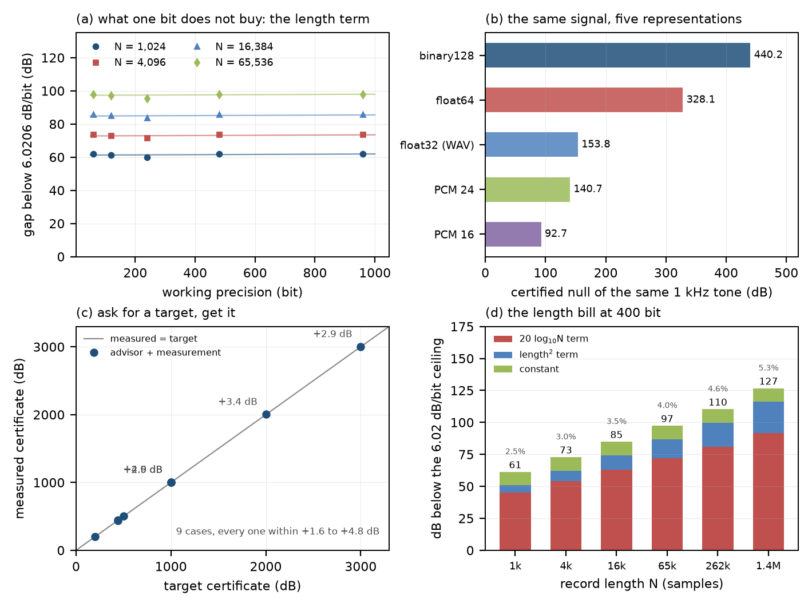

# 分支 C · 带证书的音频测量：工具链与精度律

> 2026-11-26 · 承接 `2026-11-26-certified-measurement-roadmap.md` 的 §9「值得新做」清单。
> 本轮把那五条里能落地的四条做成了可运行的工具，并顺手改掉了一个会把读数压低 6.3 dB 的模型缺陷。
> **论文仍未动**（路线图第 6 步按用户要求暂缓），本文只是工具与数据的交付记录。

---

## 0. 一句话

**测量不再是一个数，而是一个区间加上它的尺子**：`null >= 440.211 dB`（可证下界）、
`ruler 594.0 dB`（尺子自己的地板）、`regime file-limited`（这个数属于文件，不属于分析器）。
把这三件事一起打印出来，是这一轮所有工具的共同形状。

---

## 1. 七个入口，七个问题

| 工具 | 回答的问题 | 入口 |
|---|---|---|
| 证书律 `advisor.certifiable_db` | 给定精度和长度，我能证到多少 dB？ | `hpm/arb/advisor.py` |
| 反解 `advisor.bits_for` | 想证到 T dB，要多少位、多少秒？ | 同上 |
| 损耗预算 `advisor.budget` | 6.02·bits 里，哪几 dB 花在了哪里？ | 同上 |
| 流式测量 `measure.measure` | 这个文件的可证零差是多少？ | `hpm/arb/measure.py` |
| 饱和扫描 `measure.measure_auto` | 我不知道目标 dB，精度加到哪儿停？ | 同上 |
| 命令行 `certify` | 上面这些，不写 Python 怎么用？ | `python -m hpm.arb.certify` |
| DPSS 表 `dpss_table` | 想要 −120 dB 泄漏，NW 取多少？ | `python -m hpm.arb.dpss_table` |

`certify` 三个子命令：`null`（单音零差，支持 `--auto` / `--product` / `--no-dc`）、
`imd`（双音互调，一次读七个产物频率）、`predict`（精度顾问）。

---

## 2. 二次精度律：证书的损耗预算

### 2.1 律

26 个测量点（p = 60…960 bit，N = 1k…1.27M，f = 1 kHz，精确整数相位基，零 guard bit）：

    null = 6.0199·p − 4.4941·L − 0.0583·L² − 10.44   [dB]，  L = log2 N
    max|残差| = 1.84 dB，rms = 0.71 dB

同形的尺子律恒高 3.0 dB：

    coef = 6.0199·p − 4.4580·L − 0.0593·L² − 13.76   [dB]

尺子律的常数与证书律不同（L 的系数 −4.46 vs −4.49、二次项 −0.059 vs −0.058），
但用另一组点重拟合得到 −5.43·L − 0.020·L²，与代码里这组在全部 20 个尺子点上相差 ≤ 0.41 dB ——
**两条律是同一个机制的两个投影，各自拟合的系数不可互换**。

线性拟合（只有 −5.79·L）在整段上留 2.42 dB 残差，二次留 1.84 dB，所以取二次。
**但二次项的意义不在拟合精度，在于它说出了机制**：每翻倍的长度代价本身在涨。

| N | 每翻倍损失 |
|---|---:|
| 4 096 | 5.95 dB |
| 1.41 M | 6.93 dB |

`advisor.loss_per_doubling(N)` 直接给这个数：N=1k 时 5.72 dB，4k 时 5.95，65k 时 6.42，1.4M 时 6.93。

**一致性检查**：把尺子扫描与顾问验证的另外 36 个点合进来重拟合（共 62 点），得到
`6.0209·p − 4.4849·L − 0.0541·L² − 12.10`（max 2.58 dB、rms 1.21 dB），
与代码里这组常数的预测在 400 bit、N=1k…1.4M 上相差 ≤ 0.8 dB。
律是稳的；留 26 点是它只用了「同一条流水线产出的」数据。

### 2.2 三个系数分别是什么

* **6.0199 dB/bit** —— 算术天花板 6.0206 的 0.01%。一位工作精度换一位证书，没有别的东西能换。
* **−4.49·L − 0.058·L²** —— 长度不免费。残差是 N 个平方的和，球的半径按 √N 涨而信号能量按 N 涨
  （这本身只值 3 dB/倍）；Gram 矩阵累积 N 次舍入再叠一层。二次项说的是第二层在放大：
  每翻倍损失 N=1k 时 5.72 dB，4k 时 5.95，65k 时 6.42，1.4M 时 6.93 —— **涨幅本身就是二次项的导数**。
* **−0.184 dB/十倍频** —— 几乎为零，**前提是基函数用精确整数相位算**。用 `cos(w·i)` 时同一系数是
  −2.1，4 kHz 处白丢 15 dB；那不是测量的性质，是参数约化的性质（`mcore.basis_exact` 就是为这个加的）。

### 2.3 预算表

`advisor.budget(bits, N, f)` 把上式拆成可分别测量的五项。400 bit 下：

| N | 天花板 | 长度项 | 二次项 | 常数 | 证书 |
|---:|---:|---:|---:|---:|---:|
| 1 024 | 2408.2 | −44.9 | −5.8 | −10.4 | 2346.7 |
| 4 096 | 2408.2 | −53.9 | −8.4 | −10.4 | 2335.2 |
| 16 384 | 2408.2 | −62.9 | −11.4 | −10.4 | 2323.2 |
| 65 536 | 2408.2 | −71.9 | −14.9 | −10.4 | 2310.7 |
| 262 144 | 2408.2 | −80.9 | −18.9 | −10.4 | 2297.7 |
| 1 411 200 | 2408.2 | −91.8 | −24.3 | −10.4 | 2281.4 |

长度从 1k 到 1.4M，损失从 61 dB 涨到 127 dB，占天花板从 2.5% 到 5.3%。
**这就是「长文件更贵」的定量形式**：不是慢，是要多买精度。

### 2.4 那个恒定的 3 dB 缺口

证书用的是系数通道的三角不等式：`|dm| <= rad(a) + rad(b)`，两个半径相加让幅度多算 √2，
功率上正好 +3.01 dB。20 个尺子点实测 3.01–3.08 dB（均值 3.03），每个 (p, N) 都是 +3.0。改成正交式 `(ra² + rb²)/2` 能复现证书到 0.05 dB，
但它**不是上界**，所以工具里保留三角不等式、把这 3 dB 当作诚实的代价。

---

## 3. 表示阶梯：同一个信号，五种存法

同一段 1 kHz、0.5 FS 的引擎输出（16 s，44.1→88.2，1 411 200 样本），同一把尺子（120 bit，skip/tail 0.8 s）：

| 存法 | 可证零差 | 残差 rms | 说明 |
|---|---:|---:|---|
| binary128 (`.f128`) | **440.211 dB** | 3.451e−23 | 引擎的四精度输出 |
| float64 (`.f64`) | 328.091 dB | 1.393e−17 | 论文口径的地板 |
| float32 (WAV) | 153.822 dB | 7.200e−09 | |
| PCM24 (WAV) | 140.662 dB | 3.276e−08 | |
| PCM16 (WAV) | 92.701 dB | 8.192e−06 | |

每一级都精确落在该格式的表示极限上（float64 的 2⁻⁵³ 相对幅度 = 328.1 dB，
binary128 的 2⁻¹¹³ = 440.2 dB），说明**这把尺子没有参与决定任何一个读数**。

### 3.1 本轮最重要的修正：直流必须进模型

第一次做这张表时 PCM24 读 **134.332 dB**，比理论值低 6.3 dB。逐项查下来：`measure()` 的正规方程
只有 cos/sin 两列，**没有常数项**。这段合成正弦的样本均值是 −5.947e−08，占残差能量的 76.7%；
它被当成「零差」记了账。

修法是把 DC 作为第 2K+1 个未知量加进正规方程（`fit_dc=True`，默认开）。修后同一文件读
**140.662 dB**，与 numpy 最小二乘逐位一致，也与 LSB/√12 的理论值对上了：

| | 理论 | 实测 | 差 |
|---|---:|---:|---:|
| PCM24 | 140.23 dB | 140.662 | +0.43 |
| PCM16 | 92.07 dB | 92.701 | +0.63 |

**教训**：任何「残差 = 数据 − 模型」的证书，模型漏一项就等于给被测对象减分。DC 是最容易漏的一项，
因为它「看起来不像信号」。

### 3.2 求解精度必须高于数据的动态范围

同一个 float32 文件，把工作精度从 40 bit 往上扫：

| bits | 40 | 48 | 56 | 64 | 72 |
|---|---:|---:|---:|---:|---:|
| 证书 dB | 115.21 | 151.62 | 153.81 | 153.82 | 153.82 |

float32 的 153.82 dB 从 56 bit 起饱和；低于 40 bit 时 Gram 矩阵直接奇异（`arb_mat.solve` 抛
`ZeroDivisionError`，现在被翻译成带建议的 `ValueError`）。经验法则写在异常消息里：

> `6.02·bits` 必须比信号的动态范围高出约 `20log10(N)`。

---

## 4. 饱和扫描：真实文件怎么反解

引擎输出（`_eng16.f128`）的精度扫描：

| bits | 92 | 94 | 96 | 98 | 100 | 104 | 110 | 120 |
|---|---:|---:|---:|---:|---:|---:|---:|---:|
| 证书 | 426.91 | 435.09 | 438.80 | 439.86 | 440.12 | 440.21 | 440.21 | 440.21 |
| 中点 | 440.20 | 440.21 | 440.21 | 440.21 | 440.21 | 440.21 | 440.21 | 440.21 |
| 尺子 | 425.4 | 437.4 | 449.5 | 461.5 | 473.6 | 497.6 | 533.8 | 594.0 |

三件事同时可见：

1. **中点从 96 bit 起就是 440.211，一动不动** —— 那是文件的性质。
2. **证书要追到 110 bit 才贴上去** —— 那是球半径的代价，不是文件的。
3. **92 bit 时尺子 425.4，读数 426.9** —— 两条曲线交叉。尺子律是拟合（max 残差 1.53 dB），
   不是严格上界，所以 1.5 dB 的交叉在预期内；它说明的是「在这个精度上，读数和尺子已经分不开了」，
   而不是读数错了。判据因此留 20 dB 余量，而不是 2 dB。

所以 `certify null --auto` 的判据是「证书增量 < 3 dB 即饱和」：90 → 415.98，96 → 438.80，
102 → 440.19，增量 +1.39 dB < 3.0，停，报 **440.189 dB**。它同时打印 `regime` 一行，
明确这是 file-limited 还是 ruler-limited。

---

## 5. `certify`：把能力变成尺子

```
$ python -m hpm.arb.certify null hpm/experiments/_eng16.f128 --fs 88200 --f 1000 \
      --skip 0.8 --tail 0.8 --auto --bits 90
file      hpm/experiments/_eng16.f128  (auto sweep from 90 bit, step 6)
  p=  90  cert    415.980  mid    440.159  gap   24.179
  p=  96  cert    438.796  mid    440.211  gap    1.415
  p= 102  cert    440.189  mid    440.211  gap    0.022
  saturated: +1.39 dB for 6 more bits (< 3.0)
file      hpm/experiments/_eng16.f128  (f128, 1270080 samples analysed, 102 bit)
tone      1000.0 Hz, amplitude 0.500000000000
null      >= 440.189 dB   (certified; midpoint 440.211)
residual  rms 3.451e-23   (DC -6.337e-29 fitted)
ruler     min(coefficient 485.6, frequency 505.4) = 485.6 dB
regime    file-limited (the number is a property of the data); certificate is 45.4 dB below the ruler
```

同一条命令把 `--bits` 压到 94 而不加 `--auto`，同一个文件会给出另一句话：

```
null      >= 435.089 dB   (certified; midpoint 440.210)
ruler     min(coefficient 437.4, frequency 457.2) = 437.4 dB
regime    ruler-limited (raise --bits); certificate is 2.3 dB below the ruler
```

**同一个文件、同一段样本，读数从 440.19 掉到 435.09，而中点只差 0.001 dB。** 掉的那 5 dB 是球半径，
不是信号。没有 `regime` 这一行，使用者会以为这个文件只有 435 dB。

`regime` 的判据是「距尺子 20 dB 以内即 ruler-limited 并提示加 `--bits`」。这一行是整条工具链的要点：
**先证明尺子不是瓶颈，再报读数**。

IMD 子命令一次读七个产物频率（2f₁−f₂、2f₂−f₁、f₂−f₁、3f₁/2f₁+f₂/2f₂+f₁/3f₂ 的混叠位置）。
在 a₃=1e−9 的已知三次非线性文件上：

| 频率 | 身份 | 读数 |
|---:|---|---:|
| 18 000 | 2f₁−f₂ | −206.58 dBc |
| 21 000 | 2f₂−f₁ | −206.58 dBc |
| 13 900 | 2f₁+f₂ − fs | −206.58 dBc |
| 14 900 | 2f₂+f₁ − fs | −206.58 dBc |
| 12 900 | 3f₁ − fs | −216.12 dBc |
| 15 900 | 3f₂ − fs | −216.12 dBc |
| 1 000 | f₂−f₁ | −702.75 dBc |

整体 null ≥ 203.336 dB。在 150/200/300/400/800 bit 下**逐位不变**（400 bit 的尺子 2304.3 dB，
800 bit 的尺子 4712.5 dB）—— 又一次证明这些数属于文件，不属于分析器。

三阶项 −206.58 与解析值 3/4·a₃·A₁²·A₂ 差 0.00 dB；三次谐波混叠比三阶互调低 9.5 dB；
差频 −702.75 dBc 是 binary128 量化噪声的单 bin 电平（理论 −725.5 dBc），不是失真。

---

## 6. 图



(a) 证书 vs 工作精度，四个 N 的散点与二次律曲线；(b) 表示阶梯的横向条；
(c) 九例「目标 vs 实测」（全部落在 +1.6…+4.8 dB，即律略微保守）；(d) 400 bit 下的长度账单堆叠柱。

---

## 7. 精度顾问的验证

九例，给定目标 T、长度 N、频率 f，反解 bits 再实测：

| T | N | f | bits | 实测 | 余量 |
|---:|---:|---:|---:|---:|---:|
| 200 | 4 096 | 1 000 | 46 | 203.27 | +3.27 |
| 500 | 4 096 | 1 000 | 96 | 504.30 | +4.30 |
| 1 000 | 4 096 | 1 000 | 179 | 1 004.01 | +4.01 |
| 1 000 | 1 024 | 100 | 177 | 1 002.46 | +2.46 |
| 1 000 | 16 384 | 3 990 | 181 | 1 002.86 | +2.86 |
| 2 000 | 4 096 | 1 000 | 345 | 2 003.43 | +3.43 |
| 3 000 | 65 536 | 1 000 | 515 | 3 002.93 | +2.93 |
| 440 | 262 144 | 1 000 | 92 | 444.83 | +4.83 |
| 440 | 1 270 080 | 1 000 | 94 | 441.58 | +1.58 |

九例全部 ≥ T，余量 +1.6…+4.8 dB，没有一次低于目标。**律是保守的，这正是它该有的方向**。

---

## 8. 代价

### 8.1 墙钟不是正比于精度

最容易犯的错是把每样本成本写成 `常数 × bits`。实测（211 680 样本，K=1，两遍流式）：

| bits | f128 输入 | f64 输入 |
|---:|---:|---:|
| 100 | 8.34 us/样本/遍 | 4.99 us/样本/遍 |
| 200 | 10.42 | 7.32 |
| 400 | 12.60 | 9.10 |

三点连线是**仿射**的，不是过原点：

    µs/样本/遍 = 6.34 + 0.0131 × bits      （f128 输入）

固定项 4.3 us 是解码 + 相量（每样本两次三角函数），它**与精度无关**。后果是：

| bits | 固定项占每样本成本 |
|---:|---:|
| 46 | 81.9% |
| 94 | 68.8% |
| 200 | 50.9% |
| 400 | 34.2% |
| 960 | 17.8% |

**低精度端根本不是算术在花时间，而是三角函数在花时间。** 一个正比模型在 94 bit 会把 20.3 s 说成 4 s，
差 5 倍 —— 而 94 bit 正是「测引擎 440 dB」这种最常见的用例。

### 8.2 实际耗时

| 项 | 数 |
|---|---|
| 16 s 引擎输出（1.27 M 样本，94 bit，两遍流式） | 20.3 s（模型 15.9 s） |
| 同上，400 bit | 29.6 s（模型 32.0 s） |
| 单点证书（N=4096，240 bit） | 0.03 s |
| 单点证书（N=4096，3840 bit） | 0.45 s |
| `--auto` 从 90 bit 扫到 102 bit（三次全量重算） | 约 55 s |

仿射模型在 94/400 bit 两端的误差是 −22% / +8%，比原先的正比模型好一个数量级，
但它仍然是**同机同口径的标定**：换输入格式（f64 便宜 1.4 倍）、换 K、换机器都要重测。
模型只用来判断「这件事是不是几十秒的事」，不能当承诺。

---

## 9. 复现

```bash
# 先造夹具（除第一个文件外全部由它派生，整条阶梯一起动）
bash deeppggb/build_quad.sh                # -> dp_quad_probe.exe
python hpm/experiments/make_fixtures.py     # -> _eng16.f128/.f64/.wav/_pcm24/_pcm16, _syn24.wav, _imd.f128
python hpm/experiments/make_fixtures.py --check   # 重造一遍并逐字节/逐样本比对

# 证书律与反解
python hpm/experiments/run_law.py            # -> results_law.json
python hpm/experiments/run_advisor_law.py    # -> results_advisor.json
python hpm/experiments/run_validate.py       # -> results_validate2.json

# 表示阶梯（需要先有 _eng16.f128 等五个文件）
python hpm/experiments/run_ladder.py         # -> results_ladder.json
python hpm/experiments/run_minsolve.py       # 求解精度下限
python hpm/experiments/run_wallcal.py        # 墙钟标定（仿射模型的两个常数）

# 饱和扫描
python hpm/experiments/run_saturation.py     # -> results_saturation.json

# 命令行
python -m hpm.arb.certify null out.f128 --fs 88200 --f 1000 --skip 0.8 --tail 0.8 --auto
python -m hpm.arb.certify imd out.f128 --fs 44100 --f1 19000 --f2 20000
python -m hpm.arb.certify predict --db 440 --N 1270080 --f 1000
python -m hpm.arb.dpss_table                 # N×NW 泄漏上界网格
python hpm/experiments/fig_budget.py         # -> reports/figs/budget_1_5.png
```

---

## 10. 局限（必须跟着数一起说）

1. **DC 必须显式进模型**。`--no-dc` 仍保留（用于对照），但它给出的数会系统性偏低，不是「更严格」。
2. **频率项只有在精确整数相位基下才小**。工具默认走精确相位；如果调用方自己传一个 53 bit 算出来的
   ω，会凭空多出 15 dB 的损失，而且看不出是哪里来的。
3. **二次律已经验证到 3840 bit / 5.6 M 样本**（`run_law_ext.py`）：p=960/1920/3840 在 N=1.27M
   上实测比律高 +1.85/+2.52/+6.79 dB，N=2.82M/5.64M 在 p=240/480 上高 +4.38/+2.45/+5.39/+3.46 dB。
   **律在所有外推点上都偏保守**，但残差随精度增长到 6.8 dB —— 这就是 `MARGIN_DB` 存在的理由，
   也是顾问只能当规划工具、不能当上界的原因。
4. **时间模型是仿射而非正比**，在 94/400 bit 上误差 −22% / +8%，但它仍是同机标定；
   换输入格式（f64 便宜 1.4 倍）、换 K、换机器都要重测。
5. **证书是「残差能量上界」**：当区间跨 0 时只能给下界 −10log10(hi(r²)/lo(x²))，跨得越宽下界越低。
   这也是饱和扫描要一路加精度的原因。
6. **只处理单音 / 双音 + 指定产物频率**。任意多音、任意窗函数的联合拟合没有做。
7. **文件格式**：`f128` / `f64` / WAV（float32、PCM24、PCM16）已验证；FLAC 走 soundfile，
   路径通但没有做过系统的地板标定。

---

## 11. 一句话

**这把尺子现在会自己说「我够不够」**：它同时给出读数、读数的不确定度上界、和它自己的地板，
三者在同一次运行里。剩下的问题不再是「能测多深」，而是「要测的那个东西，值不值得买这么多位」。
