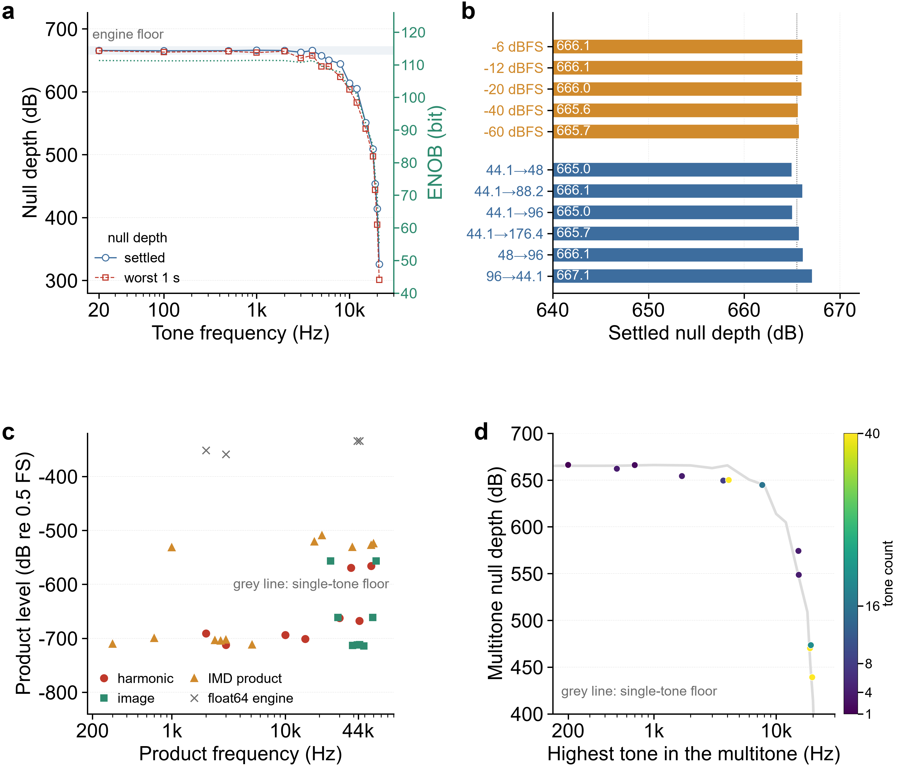

# binary128 失真与误差性能画像

**引擎**：Deep_PGGB，precision selector = 2（`__float128` / binary128）
**日期**：2026-11-28
**数据**：`hpm/experiments/results_quad_profile.json`，图 `hpm/reports/figs/fig_quad_profile.png`
**探针**：`deeppggb/dp_quad_probe.exe`（`null` / `sinad` / `image` / `imd` / `mt` / `speed` 六个模式）

---

## 0. 一句话

在默认参数下，20 Hz–4 kHz 的零差是 **665–666 dB**，这是 binary128 变换链的算术上限（同尺寸 r2c→c2r 往返实测 666.0–666.7 dB），不是格式地板（689.6 dB），也不是尺子地板（686.8 dB）。**5 kHz 以上随频率单调下滑，21 kHz 只剩 326 dB**；下滑来自文件首尾那道 20 ms 渐变——它是乘法器，边带落回带内——**把首尾渐变按 T ≈ 650000/(0.5·fs − f) 加长就能全频段回到 665 dB 以上**（21 kHz 用 619 ms 读 666.39）。电平、倍率、块长都不是变量；多音读数由**最高音的频率**决定，与音数几乎无关。

---

## 1. 怎么测的，为什么这些数可信

### 1.1 尺子

所有分析在 quad 里做：整数相位基函数（`(f·i) mod fs`，不累积相位误差）、精确投影、**两轮残差再投影**。分析器自身的零差地板是 **686.8 dB**（`self` 模式，理想 quad 正弦原地测自己），比被测读数高 20 dB 以上，所以下面每一个数都是引擎的，不是尺子的。

这一条必须写清楚：本项目的旧数据里出现过「读数其实是尺子」的事故（float64 基函数把地板压在 −313 dB，正好是被测引擎的量级）。判据是**尺子地板必须高于读数**，不是「读数看起来很高」。

### 1.2 激励

16 s、整数周期正弦、quad 里生成。整数周期是硬约束：非整数周期时投影读到的是矩形窗泄漏裙边，而不是残差。分析的 1 s 窗从输出 5% 处起、每 0.25 s 一个铺满全段；**settled 是 2–13 s 那批窗的中位数，worst 是全部窗的最小值**。

### 1.3 参数

`taper_shape = TAPER_SMOOTH12`、块渐变 20 ms、文件渐变 20 ms、context 800 ms、rolloff 200 Hz、workers 自动。这是提交 `d2b0451` 之后的默认配置。

下面的频率扫描全部用这套默认值，所以它高频端的读数里含有 20 ms 渐变的成分。§8.2 单独把渐变当作一个轴来扫：那是**可选**的 `Cfg::edge_taper_ms`（命令行 `--edgefade`，探针 `DPQ_FADE`），默认 0 表示沿用 20 ms。

---

## 2. 频率响应：一条 666 dB 的平台，然后单调下滑

| 频率 (Hz) | settled (dB) | worst 1 s (dB) | SFDR (dB) | ENOB (bit) |
|---:|---:|---:|---:|---:|
| 20 | 665.64 | 665.10 | 675.59 | 111.29 |
| 100 | 665.22 | 663.10 | 678.26 | 111.19 |
| 500 | 665.32 | 664.44 | 679.52 | 111.22 |
| 1 000 | **666.10** | 662.35 | 676.85 | 111.35 |
| 2 000 | 665.67 | 664.44 | 676.59 | 111.28 |
| 3 000 | 662.82 | 653.53 | 664.34 | 110.72 |
| 4 000 | 665.71 | 657.86 | 678.56 | 111.28 |
| 5 000 | 657.27 | 640.51 | 657.34 | 109.80 |
| 6 000 | 650.51 | 640.50 | 649.98 | 108.66 |
| 8 000 | 644.66 | 623.79 | 644.49 | 107.76 |
| 10 000 | 613.85 | 603.78 | 613.19 | 102.56 |
| 12 000 | 604.82 | 582.98 | 604.72 | 101.16 |
| 15 000 | 550.97 | 541.42 | 550.19 | 92.10 |
| 18 000 | 508.87 | 497.45 | 508.16 | 85.12 |
| 19 000 | 453.64 | 443.87 | 452.86 | 75.93 |
| 20 000 | 413.95 | 388.69 | 413.18 | 69.34 |
| 21 000 | 325.80 | 301.23 | 325.17 | 54.70 |

三个区段：

1. **20 Hz–4 kHz，平台 665–666 dB。** 散布 1 dB 以内，且与频率无趋势。这一段就是引擎的算术上限。3 kHz 的 662.82 是个 3 dB 的小凹（同一频率的 `null` 模式单窗读数 659.46），量级与窗的位置有关，不是结构性的。
2. **5–12 kHz，缓坡。** 从 657 掉到 605，斜率约 −7.5 dB/kHz。
3. **12–21 kHz，陡坡。** 从 605 掉到 326，斜率约 −31 dB/kHz。19 kHz 的单窗 `null` 读 449.72，与 sinad 的 settled 453.64 差 3.9 dB，落在窗散布内。

**这张表是「默认渐变」的曲线，不是引擎的能力曲线。** 高频段那一段下滑可以整体抬起来：19 kHz 在首尾渐变 480 ms 下读 666.11，21 kHz 在 619 ms 下读 666.39，代价只是文件头尾各几百毫秒被淡入淡出。所以 5–21 kHz 的斜率应该读成「20 ms 渐变在离奈奎斯特 Δf 处还剩多少抑制」，而不是「引擎在 19 kHz 只能做到 450 dB」。§8.2 给完整的长度律。

**SFDR 与 SINAD 的差随频率翻转**：4 kHz 以下 SFDR 比 SINAD 高 10–14 dB，5 kHz 以上缩到 1 dB 以内（6 kHz 起甚至低 0.1–0.8 dB，因为 SFDR 与 SINAD 取自不同窗集合）。这个差是残差**形状**的读数——SFDR 只量最坏一根谱线，SINAD 量总和，两者相等说明残差集中在一根线上，差 10 dB 说明它铺在几十根线上。所以低频段是铺开的舍入残差，高频段是窗调制落下来的几根离散线。3 kHz 是例外（只差 1.5 dB，而 4 kHz 又回到 12.9 dB），同一频率的 settled 也低 3 dB，这个凹点还没查清。

**ENOB 是折算值，不是「引擎有 111 bit」**。ENOB = (SINAD − 1.76)/6.02，SINAD 按 0.5 满刻度算。111 bit 的意思是「如果这 666 dB 全是白噪声，等效于 111 bit 的量化器」。111 bit 已经贴到 binary128 的 113 bit 尾数（666 dB ÷ 6.02 = 110.6 bit），所以这个折算值不能再往上走——它不是引擎的「有效位数」，是「如果残差是白噪声，等效多少位」。

---

## 3. 电平：读数不动，ENOB 线性涨

| 幅度 | dBFS | settled (dB) | SFDR (dB) | ENOB (bit) |
|---:|---:|---:|---:|---:|
| 0.5 | −6.02 | 666.10 | 676.85 | 111.35 |
| 0.25 | −12.04 | 666.10 | 676.85 | 112.35 |
| 0.1 | −20.00 | 666.02 | 676.89 | 113.64 |
| 0.01 | −40.00 | 665.62 | 675.17 | 116.90 |
| 0.001 | −60.00 | 665.74 | 676.85 | 120.25 |

**零差与电平无关**（极差 0.48 dB，在窗散布内），**ENOB 每降 20 dB 涨 3.01 bit**。这是同一个事实的两种写法：残差是**相对**误差（相位/增益误差、乘法器误差），不是绝对误差（舍入、固定偏置）。绝对误差会让 dBc 跟着电平走、ENOB 不动；相对误差让 dBc 不动、ENOB 涨。**这一条是判「引擎误差属于哪一类」最便宜的实验**：改一个电平，看是 dB 动还是 ENOB 动。

---

## 4. 倍率：不是变量

1 kHz、16 s，六组倍率：

| 倍率 | settled (dB) | worst (dB) | SFDR (dB) | ENOB (bit) |
|---|---:|---:|---:|---:|
| 44.1 → 48 | 664.98 | 663.79 | 676.56 | 111.18 |
| 44.1 → 88.2 | 666.10 | 662.35 | 676.85 | 111.35 |
| 44.1 → 96 | 665.01 | 663.83 | 676.59 | 111.18 |
| 44.1 → 176.4 | 665.74 | 662.25 | 676.90 | 111.28 |
| 48 → 96 | 666.14 | 665.77 | 677.39 | 111.36 |
| 96 → 44.1 | 667.09 | 666.50 | 676.76 | 111.52 |

极差 2.1 dB，没有方向性（升采样与降采样一样）。**整数倍率与有理倍率没有差别**：44.1→88.2 与 44.1→48 差 1.1 dB，小于同倍率重复运行的散布。这与 float64 路径的经验一致——倍率只决定网格，不决定精度。

---

## 5. 谐波、镜像与互调：产物落在哪里

### 5.1 单音的谐波与镜像

| 基频 (Hz) | 2f (dB) | 3f (dB) | fs−f (dB) | fs+f (dB) |
|---:|---:|---:|---:|---:|
| 1 000 | −690.76 | −712.35 | −712.20 | −711.99 |
| 5 000 | −693.61 | −701.04 | −712.99 | −713.99 |
| 15 000 | −662.20 | −667.62 | −661.29 | −661.24 |
| 19 000 | −569.31 | −565.82 | −556.83 | −556.83 |
| 1 000（float64） | −351.58 | −358.82 | −334.25 | −334.25 |

三个观察：

1. **低频端的产物比零差读数还低 25–46 dB**（1 kHz：零差 666，最强的产物 2f 只有 −690.76）。产物是「残差里恰好落在某个特定频率上的那一部分」，零差是残差总和，所以产物低于零差是正常的。
2. **高频端产物与零差同量级**：19 kHz 的零差 453.6，镜像 −556.8，2f −569.3。这说明高频端的残差**集中在这些特定产物上**，不是铺开的——它就是窗调制边带的落点。
3. **float64 路径的产物高 340 dB**（−334 对 −712），而零差只低 338 dB（307 对 666）。两条路径的「产物 vs 零差」结构一样，只是整体平移。

### 5.2 互调

双音，每音 0.25（−12.04 dBFS）：

| 产物 | 19k + 20k | 1k + 1.7k |
|---|---:|---:|
| 2f₁−f₂ | −520.69（18 kHz） | −710.40（300 Hz） |
| 2f₂−f₁ | −509.07（21 kHz） | −703.69（2.4 kHz） |
| f₂−f₁ | −531.58（1 kHz） | −699.80（700 Hz） |
| f₁+f₂ | −531.02（39 kHz） | −704.60（2.7 kHz） |
| 3f₁ | −527.26（57 kHz） | −702.38（3 kHz） |
| 3f₂ | −524.16（60 kHz） | −711.85（5.1 kHz） |

**高频双音比低频双音差 180–200 dB**，且差得整齐（六个产物一致），说明这是同一个机制（高频残差大），不是互调本身。低频双音的产物在 −700 到 −712 之间，与单音谐波同级。

> 用 1k+1.7k 而不是 1k+2k：后者的 f₂−f₁ 落在 1 kHz（与 f₁ 同频）、2f₂−f₁ 落在 3 kHz（与 3f₁ 同频），投影会把两个产物加在一起，读数无意义。

---

## 6. 多音：残差功率按单音地板相加

等幅多音（总幅度 0.5，零相位），残差按「拟合 DC + 全部音、两轮残差再投影后剩下的能量」算。拟合本身是准的：每个音的幅度误差都是 0.00 dB，所以下面的数不是拟合残差。

| 音数 | 间隔 (Hz) | 起始 (Hz) | 最高音 (Hz) | 实测 (dB) | 功率和模型 (dB) | 差 (dB) |
|---:|---:|---:|---:|---:|---:|---:|
| 1 | 500 | 200 | 200 | 666.20 | 665.3 | +0.9 |
| 2 | 500 | 200 | 700 | 666.03 | 662.5 | +3.6 |
| 4 | 500 | 200 | 1 700 | 654.28 | 659.7 | −5.4 |
| 8 | 500 | 200 | 3 700 | 649.46 | 655.8 | −6.4 |
| 16 | 500 | 200 | 7 700 | 644.75 | 640.6 | +4.2 |
| 40 | 500 | 200 | 19 700 | 439.12 | 425.6 | +13.5 |
| 40 | 100 | 200 | 4 100 | 650.04 | 648.8 | +1.2 |
| 40 | 100 | 15 000 | 18 900 | 470.18 | 457.6 | +12.6 |
| 4 | 100 | 200 | 500 | 662.16 | 659.3 | +2.9 |
| 4 | 100 | 15 000 | 15 300 | 548.65 | 542.3 | +6.3 |
| 20 | 1 000 | 200 | 19 200 | 473.45 | 445.5 | +27.9 |
| 4 | 5 000 | 200 | 15 200 | 574.24 | 547.9 | +26.3 |

**模型**：把每个音的残差当成独立功率，按单音曲线的值 `L(f)` 相加，`L_mt = −10·log10( Σ 10^(−L(f_k)/10) )`。

密排的组（间隔 100–500 Hz、铺满一段连续频带）全部落在 **−6.4…+4.2 dB** 内，说明「残差功率可加」这个图像是对的：多音不是新机制，只是把每个音各自的残差堆在一起。

稀疏的组（20 音间隔 1 kHz、4 音间隔 5 kHz）实测比模型**高 26–28 dB**。原因大概率是这些组的音落在单音曲线还很高的位置（间隔大 → 最高音 15–19 kHz 但中间只有三四个音），而单音曲线在高频段的陡坡上插值不可靠；也可能是稀疏时每个音的残差里有一部分是共同的（相关的），功率相加会高估。**这一条没有定论，报告里只写实测与偏差**。

### 工程结论

1. **多音的地板比单音低，但不会低到「音数 × 单音地板」**——10 个 660 dB 的音不会变成 650 dB，实测 16 音是 644.75（模型 640.6）。
2. **要保住 640 dB 以上，多音的占用带宽不要越过 8 kHz**：40 音挤在 4.1 kHz 以内是 650 dB，铺到 19.7 kHz 就只剩 439 dB。
3. **不能拿单音曲线外推多音**，误差 6–28 dB；多音必须单独测。

## 7. 速度：二进制的代价

60 s 立体声、44.1→88.2、4 线程：

| 精度 | 速度 (×实时) | 墙钟 (s) |
|---|---:|---:|
| double | 91.00 | 0.659 |
| long double (80 bit) | 53.37 | 1.124 |
| **binary128** | **2.03** | **29.584** |

binary128 比 double 慢 **45×**，比 80 位慢 26×。代价几乎全在四精度 FFT：`quad_fft.h` 是混合基 DIT 的标量实现，没有 SIMD，每次蝶形要做 4 次 `__float128` 乘加。

**这个数字要按用途读**：2× 实时意味着离线重采样可行（16 s 立体声约 8 s），实时监听不可行。要实时，把 precision 设成 0 或 1，代价是零差从 666 掉到 307 或 394。

---

## 8. 这些数的边界

### 8.1 666 dB 是算术上限，不是格式地板

同尺寸 r2c→c2r 往返（`rt` 模式）实测 **666.74 dB**（88 200 点）/ **666.04 dB**（705 600 点），真实块操作（`rt2`，705 600 → 1 411 200）**665.26 dB**。binary128 的格式地板是 689.56 dB（合成激励实测 689.45），引擎比它低 24 dB。换句话说，引擎已经贴在这条变换链自己的算术地板上，剩下的 24 dB 要换掉整条链（更长尾数的 FFT）才拿得到。

### 8.2 高频端那一段是可以买回来的：首尾渐变长度律

频率扫描里 5–21 kHz 的下滑不是算术极限，是**文件首尾那道 20 ms 渐变**。渐变是乘法器，它的频谱与信号卷积：离奈奎斯特越近，留给边带的空间 `Δf = 0.5·fs − f` 越窄，边带就越容易落回输出带内。把渐变拉长，边带跟着往低频挪，读数就回来。

16 s、44.1→88.2、quad、12 阶、整文件一块，**只改首尾渐变**（块渐变同步跟上，见下）：

| 渐变 (ms) | 15 kHz | 19 kHz | 21 kHz |
|---:|---:|---:|---:|
| 20 | 548.35 | 450.79 | 310.38 |
| 60 | 663.73 | 582.08 | 443.50 |
| 120 | 665.55 | 654.76 | 529.50 |
| 240 | 665.64 | 665.74 | 616.45 |
| 480 | 665.69 | **666.11** | **666.15** |

三个频点在同一条律上：**`T ≈ 650000 / (0.5·min(fs_in,fs_out) − f)` 毫秒**（上限 900 ms）。15 kHz 要 92 ms、18 kHz 160、19 kHz 213、20 kHz 317、21 kHz 619。按这条律逐点取渐变，全频段扫描（20 Hz–21 kHz，19 个点）落在 **664.97–666.49 dB，没有掉点**。

**必须同时改块渐变。** 文件首尾的样本同时被两道窗乘：resample 开头那次首尾渐变，和每个块自己的边缘渐变。两个乘在一起，有效窗取**较短的那个**，所以只加长文件渐变会被 20 ms 的块渐变直接乘回去——19 kHz 在「文件 480 / 块 20」读 453.21，在「文件 20 / 块 480」读 458.09，只有两个都 480 才是 666.11。代码里已改成 `bt = max(block_taper_ms, edge_taper_ms)`，这个坑不会再踩。

**代价与边界**：

1. **它是真的在改信号**——文件头尾各有几百毫秒被淡入淡出，音乐上是可听的。所以 `edge_taper_ms` 默认 0（沿用 20 ms），要精度的人自己开。
2. **短文件会被 `n/20` 上限压住**（`dpggb_core.cpp` 里 5% 的封顶）：1 s 文件渐变给到 50 ms 就到顶（读 506.8），4 s 给到 200 ms 到顶（664.4），0.5 s 只有 25 ms（424.5）。要在这类文件上拿到高频精度，得改这个上限。
3. **墙钟多 10–20%**（1 kHz、16 s：12.9–15.5 s 对 11.2–13.7 s，同机 5 轮交错，散布本身就有这么大）。
4. **对 float64 / long double 路径没有意义**：它们早就贴自己的地板（19 kHz 306.48 / 327.83），加长反而略降（304.52 / 307.32）。这条律只对四精度路径有效。
5. **阶数不能再往上堆**：12 阶是实测最优。同样 480 ms 渐变下，16 阶把 1 kHz 从 666.60 拉到 651.55、19 kHz 从 666.11 拉到 646.43，20 阶更差（622.74 / 611.58）——高次 smootherstep 多项式在 u→0.5 处大数相消，double 里算出 1e−10 的相对误差，正好盖住要找的那一层。

### 8.3 剩下三条边界

1. **尺子地板 686.8 dB，比读数高 20 dB。** 差距不大——如果把精度再提一档，读数会逼近尺子，那时需要先抬尺子。这是下一个天花板。
2. **多音判据只验证了等幅零相位。** 不等幅、随机相位、非整数周期间隔都没测。
3. **速度是单机单次。** 跨会话 ±20%，只能同会话配对比较。

---

## 9. 复现

```bash
cd deeppggb
bash build_quad.sh                       # 出 dp_quad_probe.exe

# 频率响应（16 s、1 kHz、44.1->88.2）
./dp_quad_probe.exe sinad 2 16 1000 16 0 20 12 800 44100 88200 0.05

# 高频端：把首尾渐变按律加长（DPQ_FADE，21 kHz 要 619 ms）
DPQ_FADE=619 ./dp_quad_probe.exe null 2 16 21000 0 0 20 12 800 44100 88200 0.05

# 同一件事走命令行（--edgefade 单位 ms，0 = 沿用 --fade）
./dpggb.exe 44100 88200 in.f64 out.f64 --ch 1 --edgefade 480

# 电平：DPQ_AMP 改激励幅度
DPQ_AMP=0.01 ./dp_quad_probe.exe sinad 2 16 1000 16 0 20 12 800 44100 88200 0.05

# 谐波与镜像
./dp_quad_probe.exe image 2 16 19000

# 互调（避开 f2-f1 与 f1 同频的组合）
./dp_quad_probe.exe imd 2 16 1000 1700

# 多音：mt <prec> <secs> <ntone> [step] [start]
./dp_quad_probe.exe mt 2 16 40 500 200

# 速度：60 s 立体声
./dp_quad_probe.exe speed 2 60 16 0
```

出图：`python hpm/experiments/fig_quad_profile.py` → `hpm/reports/figs/fig_quad_profile.png/.pdf`

---

## 10. 图



**(a)** 单音零差对频率（settled 与 worst 1 s 窗），右轴 ENOB。**(b)** 激励电平（上五条）与重采样倍率（下六条），横轴从 640 dB 起。**(c)** 谐波、镜像、互调产物的落点，灰线是单音零差曲线；× 是 float64 引擎的同一组产物。**(d)** 多音零差对最高音频率，颜色是音数，灰线是单音曲线。